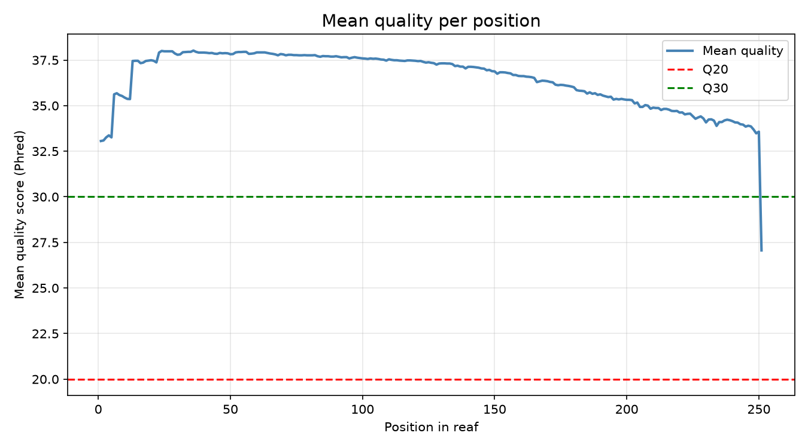
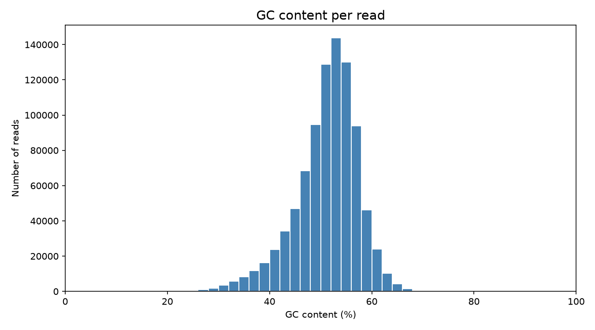
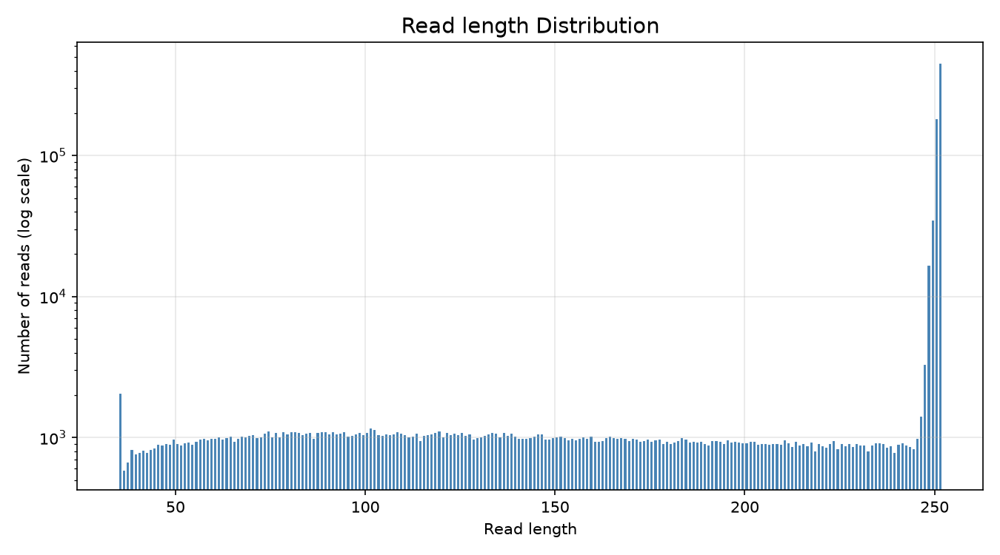

fastq-qc
A command-line tool that checks the quality of a FASTQ file, summarises it, filters out low-quality reads, and optionally draws plots.
I built it as a learning project in plain Python. The parsing, validation and statistics are written from scratch, with only `matplotlib` used for plots. Mature tools like FastQC already exist, so this is not a replacement for them. It is a way for me to understand what a QC report actually calculates.
---
What it does
Reads a FASTQ file one read at a time, so large files do not need to fit in memory
Validates every read and stops with a clear message if the file is broken
Reports read counts, read lengths, N bases, GC content, and quality statistics
Writes a new FASTQ file containing only the reads that pass a mean-quality threshold
Saves three plots: quality per position, read length distribution, and GC content per read
Statistics reported
Statistic	How it is calculated
Total reads / bases	Counted from the file
N bases	Bases that are `N` (unidentified)
Mean quality	Average Phred score over all bases
Q20 / Q30 percentage	Share of bases with Phred score at least 20 / 30
GC content (file)	(G + C) divided by identified bases, N excluded
GC content (per read)	Same formula for each read, then min, max and average
Read length	Minimum, maximum and average
Mean quality per position	Average score at position 1, 2, 3 and so on across all reads
Reads passed / removed	A read passes if its mean quality is at least the threshold
Validation checks
Each read must pass these, in this order:
The header line starts with `@`
The third line starts with `+`
The sequence contains only `A`, `C`, `G`, `T`, `N` (lowercase is accepted)
The sequence and quality lines have the same length
The tool also reports an empty file, and a file whose line count is not a multiple of 4.
---
Installation
Requires Python 3.8 or newer.
```bash
git clone https://github.com/prasiddhi5725-cpu/fastq-qc.git
cd fastq-qc
pip install -r requirements.txt
```
`matplotlib` is needed for plots, and `pytest` for the tests. The core analysis uses only the Python standard library.
---
Usage
```bash
python3 program.py -i sample.fastq
```
Options
Option	Meaning	Default
`-i`, `--input`	Input FASTQ file (required)	none
`-t`, `--threshold`	Minimum mean read quality to keep a read	20
`-o`, `--output`	File that receives the reads that pass	`filtered.fastq`
`--plot`	Save the three plots	off
`--verbose`	Print per-read lines, read lengths, and per-position means	off
Without `--verbose`, only the summary is printed. This matters on large files, because printing a line for every read is very slow.
Examples
```bash
# summary only
python3 program.py -i sample.fastq

# stricter threshold, custom output file, with plots
python3 program.py -i sample.fastq -t 25 -o strict.fastq --plot

# print everything, one line per read
python3 program.py -i sample.fastq --verbose
```
Output files
File	Created when
`filtered.fastq` (or the name given with `-o`)	always
`quality_plot.png`	with `--plot`
`read_length_plot.png`	with `--plot`
`gc_plot.png`	with `--plot`
If a read in the input is invalid, the tool stops, prints which read and why, and warns that the output file is incomplete.
---
Example
Running on the included `test.fastq` (6 short reads made by hand to test edge cases) gives:
```text
Mean quality of the file: 30.77
GC content is: 50.0 % .
Maximum read length is:  20
Minimum read length is:  10
The average read length is:  18.33
Total number of reads is:  6
Total number of bases is:  110
4  bases were unidentified.
106 bases were identified as nucleotide bases.
Quality threshold:  20
Reads passed:  6
Reads removed:  0
Bases with Q20 or higher:  92.73 %
Bases with Q30 or higher:  70.91 %
Minimum GC content:  0.0
Maximum GC content:  100.0
Average GC content:  50.83
```
---
Results on real data
I ran the tool on a public sequencing run from NCBI SRA (accession `SRR11180057`, about 435 MB).
```text
Total number of reads:    903,571
Total number of bases:    203,043,831
Mean quality of the file: 36.59
Bases with Q20 or higher: 96.76 %
Bases with Q30 or higher: 95.0 %
GC content:               51.41 %
Read length:              35 to 251 (average 224.71)
Reads passed (Q >= 20):   901,359
Reads removed:            2,212
```
Run time: TODO: Approximately 1 minute and 33.
Plots
Mean quality per position. The quality is high along the whole read and drifts down toward the end, which is the usual pattern for this kind of data.

GC content per read. A single smooth peak around 52 percent.

Read length distribution. Almost all reads are about 250 bases long, with a short tail of trimmed reads.

---
Tests
```bash
pytest
```
The tests cover the small functions: GC counting, GC percentage, quality decoding, per-position means, and read validation. Expected answers were calculated by hand.
---
Project layout
```text
.
├── program.py        # reading, validation, statistics, report, command line
├── plot.py           # the three plotting functions
├── test_main.py      # pytest tests
├── test.fastq        # small hand-made file for trying the tool
├── requirements.txt
└── README.md
```
---
Limitations
Single-end reads only. Paired-end files (two files) are not supported yet.
Plain `.fastq` only. Compressed `.fastq.gz` files are not supported yet.
Assumes Phred+33 quality encoding, which is what current Illumina data uses.
Written in plain Python, so it is much slower than established tools on large files.
Planned
`.fastq.gz` support
Paired-end mode
A Snakemake workflow to run it on many samples
---
Author
Prasiddhi Regmi, BSc Bioinformatics student at Kathmandu University.